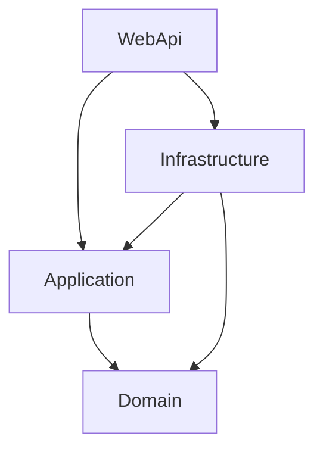
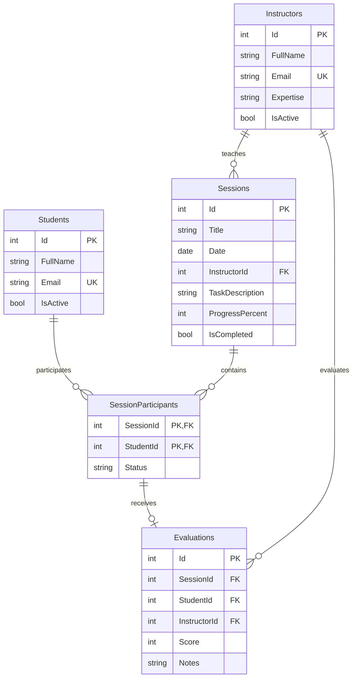
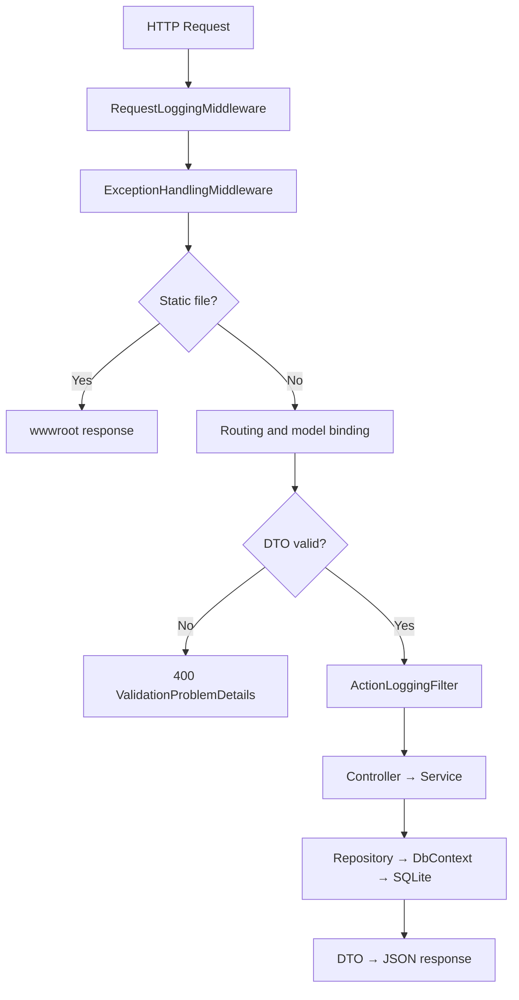

# معماری، ساختار و دیاگرام‌ها

## چرا این سطح پیچیدگی؟

در پروژه قبلی، `Program.cs` شامل منوی Console، چهار متد `AddBook/ShowBooks/EditBook/DeleteBook`، `Book` و `BookContext` است. از `EnsureCreated()` و SQLite استفاده می‌کند. فایل csproj فعلی آن `net11.0` و EF Core `10.0.14` دارد؛ این پروژه طبق درخواست شما **net10.0** است. هیچ تغییری در مخزن قبلی انجام نشده است.

اسلایدهای ۹–۲۰ درباره EF، DbContext، Migration و Tracking؛ ۲۲–۲۵ درباره HTTP؛ و ۲۶–۳۵ درباره Controller، DI، DTO و CRUD هستند. اسلاید ۳۶ معماری لایه‌ای و مدیریت خطا را ادامه مسیر معرفی می‌کند. بنابراین پروژه فقط یک گام کنترل‌شده جلو می‌رود: متدهای CRUD را تقسیم می‌کنیم و قوانین جلسه را در Service قرار می‌دهیم. SQL Server و LocalDB اسلایدها با SQLite جایگزین شده‌اند تا اجرای macOS ساده باشد.

## وابستگی زمان کامپایل

فلش یعنی «به این پروژه وابسته است». Domain هیچ وابستگی به EF یا HTTP ندارد. Application قرارداد Repository را می‌شناسد. Infrastructure آن قرارداد را با EF اجرا می‌کند. WebApi در `Program.cs` پیاده‌سازی‌ها را به DI معرفی می‌کند؛ Controllerها Repository یا DbContext را مستقیم صدا نمی‌زنند.

این Clean Architecture ساده است؛ Aggregate، CQRS، Domain Event، Generic Repository و Mapping library اضافه نشده‌اند.

## ساختار فایل‌ها

| مسیر | اجزا |
|---|---|
| `src/BootCamp.Manager.Domain/Entities/` | `Student.cs`, `Instructor.cs`, `Session.cs`, `SessionParticipant.cs`, `AttendanceStatus.cs`, `Evaluation.cs` |
| `src/BootCamp.Manager.Application/DTOs/` | `Requests.cs`, `Responses.cs` |
| `src/BootCamp.Manager.Application/Interfaces/` | چهار `I...Repository.cs` |
| `src/BootCamp.Manager.Application/Services/` | `StudentService.cs`, `InstructorService.cs`, `SessionService.cs`, `EvaluationService.cs` |
| `src/BootCamp.Manager.Application/Exceptions/` | `AppException.cs` |
| `src/BootCamp.Manager.Infrastructure/Data/` | `BootcampDbContext.cs` |
| `src/BootCamp.Manager.Infrastructure/Repositories/` | چهار پیاده‌سازی Repository |
| `src/BootCamp.Manager.Infrastructure/Migrations/` | InitialCreate، Designer و ModelSnapshot |
| `src/BootCamp.Manager.WebApi/Controllers/` | چهار API Controller و `LearningController.cs` |
| `src/BootCamp.Manager.WebApi/Middleware/` | `RequestLoggingMiddleware.cs`, `ExceptionHandlingMiddleware.cs` |
| `src/BootCamp.Manager.WebApi/Filters/` | `ActionLoggingFilter.cs` |
| `src/BootCamp.Manager.WebApi/Models/` | `GreetingForm.cs` برای نمونه MVC |
| `src/BootCamp.Manager.WebApi/Views/` | `_ViewImports.cshtml` و `Learning/Index.cshtml` |
| `src/BootCamp.Manager.WebApi/wwwroot/` | `index.html`, `css/styles.css`, `js/app.js`, `js/data.js`, `fonts/` |
| `src/BootCamp.Manager.WebApi/Program.cs` | Composition Root: تنظیم DI، اتصال DB و HTTP Pipeline |
| `src/BootCamp.Manager.WebApi/appsettings.json` | سطح لاگ و میزبان‌های محلی |
| `src/BootCamp.Manager.WebApi/Properties/launchSettings.json` | پروفایل اجرای محلی روی پورت 5083 |
| `docs/` | کپی UI با `js/data.js` مستقل و ساختگی |
| `scripts/` | داده نمونه از راه API و همگام‌سازی فایل‌های UI دمو |
| `tests/` | تست یکپارچه Python و تست قرارداد دمو با Node |
| `documentation/` | راهنماهای فارسی و SQL تولیدشده |
| `.config/dotnet-tools.json` | نسخه محلی ابزار `dotnet-ef` |
| `global.json` | انتخاب SDK 10 |
| `.gitignore` | کنار گذاشتن bin/obj و دیتابیس محلی |

## ERD

`SessionParticipants` رابطه چندبه‌چند دانشجو و جلسه را به دو رابطه یک‌به‌چند تبدیل می‌کند. کلید اصلی مرکب `(SessionId, StudentId)` مانع ثبت دوباره دانشجو در همان جلسه می‌شود. این جدول علاوه بر رابطه، وضعیت حضور را نگه می‌دارد؛ پس یک جدول واسط واقعی با داده اضافی است.

ارزیابی با **Foreign Key مرکب** به شرکت‌کننده وصل است؛ بنابراین صرف وجود Student کافی نیست، باید عضویت در همان Session نیز وجود داشته باشد. Unique روی همان دو ستون، یک ارزیابی برای هر عضویت را تضمین می‌کند. مدرس جلسه و مدرس ارزیاب می‌توانند متفاوت باشند.

| حذف | رفتار SQL/برنامه |
|---|---|
| Session | `CASCADE` به شرکت‌کنندگان؛ از آنجا به ارزیابی‌ها |
| Student دارای شرکت در جلسه | `RESTRICT`؛ Service پیش از SQL پیام `409` می‌دهد |
| Instructor دارای جلسه یا ارزیابی | `RESTRICT`؛ پیشنهاد غیرفعال کردن |
| Evaluation | فقط همان ارزیابی حذف می‌شود |

غیرفعال کردن Student فقط انتخاب او برای جلسه‌های جدید را متوقف می‌کند. ویرایش نام او در جلسات قبلی هم دیده می‌شود؛ چیزی که ثابت مانده **عضویت و مخرج درصد حضور** است، نه یک کپی تاریخی از تمام مشخصات فرد.

## مسیر درخواست و پاسخ

برای مثال `PUT /api/sessions/3/attendance`: JSON به `AttendanceRequest` تبدیل می‌شود، enum و قالب DTO بررسی می‌شوند، SessionService مجموعه شناسه‌ها را با فهرست جلسه مقایسه می‌کند و بعد از معتبر بودن کل درخواست، تمام وضعیت‌ها را تغییر می‌دهد. یک `SaveChangesAsync` ذخیره را در تراکنش انجام می‌دهد؛ ورودی نامعتبر نباید نیمی از حضور را ذخیره کند.

پاسخ در جهت برگشت از Middlewareها عبور می‌کند. ثبت درخواست بیرونِ مدیریت خطا است تا کد نهایی 400/409/500 را ببیند. Action Filter فقط بخش اجرای Action را می‌بیند، بنابراین فایل CSS یا خطای validation که پیش از Action رخ می‌دهد لزوماً لاگ Action ندارد.
