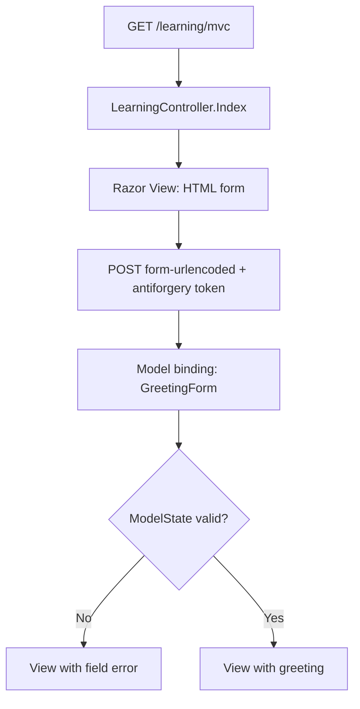

# Middleware، Action Filter، MVC و انواع فرم

## فرق مفاهیم

| مفهوم | جایگاه | ورودی/خروجی رایج | مثال این پروژه |
|---|---|---|---|
| Middleware | خط پردازش HTTP در سطح برنامه | HttpContext و RequestDelegate | زمان، Method، Path و Status درخواست |
| Action Filter | داخل مسیر اجرای Action کنترلر | ActionExecutingContext / ActionExecutedContext | لاگ قبل و بعد اجرای Action |
| MVC | الگوی Model–View–Controller | Controller مدل را به View می‌دهد و HTML ساخته می‌شود | `/learning/mvc` |
| HTML Form | قابلیت استاندارد مرورگر؛ معماری بک‌اند نیست | GET query یا POST form body | `<form method="post">` نمونه MVC |
| Razor Pages | مدل صفحه‌محور ASP.NET Core | `.cshtml` با `@page` و PageModel و OnGet/OnPost | فقط توضیح؛ در پنل استفاده نشده |
| ASP.NET Web Forms | فریم‌ورک قدیمی مبتنی بر .NET Framework | `.aspx`، Code-behind، Server Controls، PostBack و ViewState | در پروژه وارد نشده |

## Middleware دقیقاً چه می‌کند؟

```csharp
public async Task InvokeAsync(HttpContext context)
{
    // قبل از ادامه مسیر
    await next(context);
    // بعد از برگشت پاسخ
}
```

ترتیب registration مهم است. در این پروژه RequestLogging بیرون ExceptionHandling است؛ اگر Service خطا بدهد، مدیریت خطا آن را به پاسخ HTTP تبدیل می‌کند و logger کد پاسخ نهایی را می‌بیند. درخواست فایل استاتیک هم از این دو عبور می‌کند. Body درخواست لاگ نمی‌شود؛ برای تمرین Method، Path، Status، زمان و TraceId کافی است.

Middleware مدیریت خطا `AppException` را به 400/404/409 نگاشت می‌کند، خطای constraint SQLite را 409 و خطای پیش‌بینی‌نشده را 500 می‌کند. قرار نیست اعتبارسنجی `[ApiController]` را دوباره اجرا کند؛ آن خطاها از مسیر framework پاسخ داده می‌شوند.

## Filter چه تفاوتی دارد؟

`ActionLoggingFilter` از `IAsyncActionFilter` استفاده می‌کند. `await next()` در آن فقط محدوده Action را اجرا می‌کند. filter به نام Action و نتیجه/Exception آن دسترسی دارد. فایل CSS Action نیست و filter روی آن اجرا نمی‌شود. Action Filter بعد از model binding است؛ validation خودکار ممکن است پیش از آن درخواست را کوتاه کند.

این filter به صورت global در `AddControllersWithViews` ثبت شده، بنابراین برای چهار API Controller و LearningController فعال است. Action Filter برای Razor Pages به همین شکل کاربرد ندارد؛ Razor Pages برای handlerها Page Filter دارد. این دو را یکی ننامید.

## MVC در پروژه ما

پنل اصلی HTML/CSS/JS است و API Controller از `ControllerBase` ارث می‌برد. نمونه آموزشی از `Controller` ارث می‌برد، چون متد `View()` لازم دارد. `Controller` امکانات View را به ControllerBase اضافه می‌کند.



Model: `Models/GreetingForm.cs`، Controller: `Controllers/LearningController.cs`، View: `Views/Learning/Index.cshtml`.

```csharp
[HttpPost, ValidateAntiForgeryToken]
public IActionResult Index([FromForm] GreetingForm input)
{
    if (!ModelState.IsValid) return View(input);
    ViewBag.Message = $"سلام {input.Name.Trim()}؛ فرم در Controller پردازش شد.";
    return View(input);
}
```

View با Tag Helper فرم POST و token پنهان را می‌سازد. `[FromForm]` بدنه `application/x-www-form-urlencoded` را می‌خواند. Razor خروجی نام کاربر را HTML-encode می‌کند. این مثال عمداً چیزی در DB ذخیره نمی‌کند و بعد از POST همان View را نشان می‌دهد؛ در فرمِ ثبت واقعی بهتر است پس از موفقیت از Post/Redirect/Get برای جلوگیری از ارسال دوباره با refresh استفاده شود.

## تست دستی مثال

۱. برنامه را اجرا کنید و `http://localhost:5083/learning/mvc` را باز کنید.
۲. نام وارد کنید و ارسال بزنید؛ پیام سلام از سرور در HTML جدید می‌آید.
۳. اگر JavaScript مرورگر خاموش باشد هم کار می‌کند.
۴. نام خالی یا فقط فاصله اعتبارسنجی می‌شود. اعتبارسنجی HTML مرورگر ممکن است ارسال خالی را جلوتر متوقف کند؛ تست Python حالت server-side را مستقیم می‌فرستد.
۵. POST بدون antiforgery token باید 400 بدهد. تست `tests/smoke.py` ابتدا GET می‌کند، cookie و token را می‌گیرد و فرم معتبر/نامعتبر را آزمایش می‌کند.

## HTML Form در برابر Fetch

Form معمولی با submit، مرورگر را به پاسخ سرور می‌برد. `method="get"` فیلدها را در query string و `method="post"` معمولاً در form-urlencoded می‌فرستد. `enctype="multipart/form-data"` برای فایل است. Fetch در پنل JSON می‌فرستد و بدون reload کل صفحه، state و کارت‌ها را تازه می‌کند. هیچ‌کدام به‌خودی‌خود MVC یا Razor Pages نیستند.

## Razor View با Razor Pages یکی نیست

هر دو می‌توانند `.cshtml` داشته باشند. در نمونه MVC ما View فاقد `@page` است و توسط Controller انتخاب می‌شود. در Razor Pages، `@page` فایل را endpoint می‌کند و PageModel با `OnGet/OnPost` رفتار صفحه را مدیریت می‌کند. برای کوچک ماندن پروژه یک نمونه MVC کافی است و Razor Pages موازی به آن اضافه نشده است.

## Web Forms و macOS

ASP.NET Web Forms قدیمی بخشی از .NET Framework و متکی به پشته Windows/IIS است. ASP.NET Core و .NET 10 از Web Forms پشتیبانی نمی‌کنند. نصب SDK 10 روی macOS نمی‌تواند پروژه `.aspx` کلاسیک را به شکل پشتیبانی‌شده اجرا کند. برای تمرین واقعی Web Forms به محیط Windows با .NET Framework و IIS/IIS Express نیاز دارید؛ مثلاً یک ماشین Windows یا ماشین مجازی مناسب. در macOS همین MVC، Razor Pages و Web API با ASP.NET Core قابل اجرا هستند.

به‌کار بردن عبارت «Web Form» برای هر فرم HTML ممکن است باعث اشتباه شود: فرم HTML این پروژه Web Forms قدیمی نیست. کد `System.Web` یا ViewState به پروژه Core اضافه نشده است.

## منابع رسمی

- [ASP.NET Core Middleware](https://learn.microsoft.com/en-us/aspnet/core/fundamentals/middleware/?view=aspnetcore-10.0)
- [Filters in ASP.NET Core](https://learn.microsoft.com/en-us/aspnet/core/mvc/controllers/filters?view=aspnetcore-10.0)
- [انتخاب .NET یا .NET Framework و محدودیت Web Forms](https://learn.microsoft.com/en-us/dotnet/standard/choosing-core-framework-server)
- [EF Core Migrations](https://learn.microsoft.com/en-us/ef/core/managing-schemas/migrations/)

منابع در ۲۶ نوامبر ۲۰۲۶ بررسی شدند؛ مثال پروژه مشخصاً هدف net10.0 دارد حتی اگر سایت مستندات نسخه جدیدتر را پیشنهاد کند.
